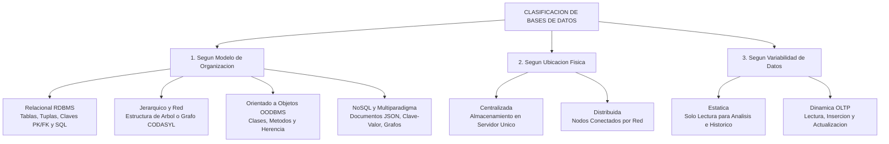
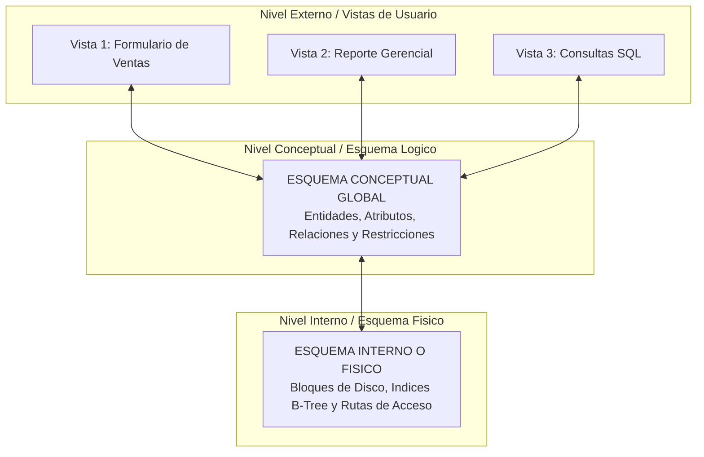
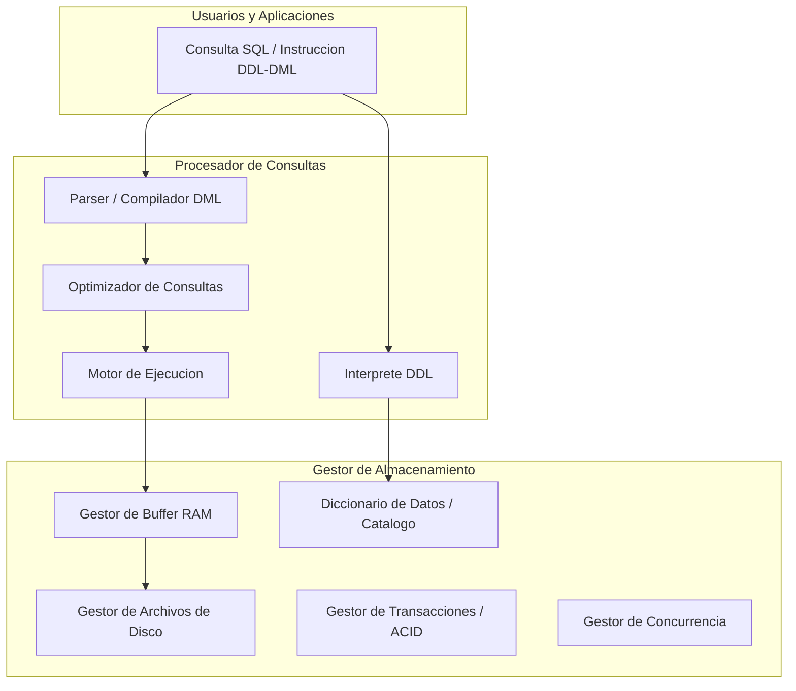

# 📘 Tarea 1.2: Clasificación y Arquitecturas (ANSI/SPARC y SGBD)

## 👤 Datos de Identificación

* **Nombre:** Leonardo Martinez Salinas
* **Matrícula:** I24050412
* **Maestro:** Ruben Riojas
* **Asignatura:** Fundamentos de Bases de Datos
* **Unidad:** [Unidad 1 — Introducción a las Bases de Datos](../)

---

## 📑 Descripción

En esta actividad se investigan y estructuran la **clasificación de las bases de datos** y las **arquitecturas fundamentales de los sistemas de datos**. El desarrollo comprende los dos ejes temáticos solicitados:

1. **Cuadro Sinóptico sobre la Clasificación de las Bases de Datos:** Clasificación detallada según el **modelo de organización** (Relacional, Jerárquico, En Red, OODBMS, NoSQL), la **ubicación física** (Centralizada vs Distribuida) y la **variabilidad/contenido de los datos** (Estática vs Dinámica).
2. **Arquitecturas de Bases de Datos y SGBD:**
   - **Arquitectura de Tres Niveles ANSI/SPARC:** Descripción y esquematización del Nivel Externo o Vistas, Nivel Conceptual y Nivel Interno/Físico, junto con la explicación formal de la **Independencia Lógica y Física de Datos**.
   - **Arquitectura Funcional Interna del SGBD (DBMS):** Desglose detallado del **Procesador de Consultas** (Compilador DML, Intérprete DDL, Optimizador y Motor de Ejecución) y del **Gestor de Almacenamiento** (Gestor de Archivos, Buffer Manager, Gestor de Transacciones/Concurrencia y Diccionario de Datos).

---

## 📊 Visualización de Gráficos

### 1. Cuadro Sinóptico: Clasificación de las Bases de Datos (Mermaid.js)

```text
graph TD
    Root["CLASIFICACION DE BASES DE DATOS"]

    Root --> C1["1. Segun Modelo de Organizacion"]
    Root --> C2["2. Segun Ubicacion Fisica"]
    Root --> C3["3. Segun Variabilidad de Datos"]

    C1 --> M1["Relacional RDBMS<br>Tablas, Tuplas, Claves PK/FK y SQL"]
    C1 --> M2["Jerarquico y Red<br>Estructura de Arbol o Grafo CODASYL"]
    C1 --> M3["Orientado a Objetos OODBMS<br>Clases, Metodos y Herencia"]
    C1 --> M4["NoSQL y Multiparadigma<br>Documentos JSON, Clave-Valor, Grafos"]

    C2 --> U1["Centralizada<br>Almacenamiento en Servidor Unico"]
    C2 --> U2["Distribuida<br>Nodos Conectados por Red"]

    C3 --> V1["Estatica<br>Solo Lectura para Analisis e Historico"]
    C3 --> V2["Dinamica OLTP<br>Lectura, Insercion y Actualizacion"]
```



---

### 2. Arquitectura de Tres Niveles ANSI/SPARC (Mermaid.js)

```text
graph TD
    subgraph NE ["Nivel Externo / Vistas de Usuario"]
        V1["Vista 1: Formulario de Ventas"]
        V2["Vista 2: Reporte Gerencial"]
        V3["Vista 3: Consultas SQL"]
    end

    subgraph NC ["Nivel Conceptual / Esquema Logico"]
        Conceptual["ESQUEMA CONCEPTUAL GLOBAL<br>Entidades, Atributos, Relaciones y Restricciones"]
    end

    subgraph NI ["Nivel Interno / Esquema Fisico"]
        Interno["ESQUEMA INTERNO O FISICO<br>Bloques de Disco, Indices B-Tree y Rutas de Acceso"]
    end

    V1 <--> Conceptual
    V2 <--> Conceptual
    V3 <--> Conceptual
    Conceptual <--> Interno
```



---

### 3. Arquitectura Funcional Interna del SGBD (Mermaid.js)

```text
graph TD
    subgraph User ["Usuarios y Aplicaciones"]
        App["Consulta SQL / Instruccion DDL-DML"]
    end

    subgraph QP ["Procesador de Consultas"]
        Parser["Parser / Compilador DML"]
        DDLCompiler["Interprete DDL"]
        Optimizer["Optimizador de Consultas"]
        ExecEngine["Motor de Ejecucion"]
    end

    subgraph SM ["Gestor de Almacenamiento"]
        BufferMgr["Gestor de Buffer RAM"]
        FileMgr["Gestor de Archivos de Disco"]
        TransMgr["Gestor de Transacciones / ACID"]
        LockMgr["Gestor de Concurrencia"]
        Dict["Diccionario de Datos / Catalogo"]
    end

    App --> Parser
    App --> DDLCompiler
    Parser --> Optimizer
    Optimizer --> ExecEngine
    ExecEngine --> BufferMgr
    BufferMgr --> FileMgr
    DDLCompiler --> Dict
```



---

## 📚 Referencias Bibliográficas (Formato APA 7.ª Edición)

* Date, C. J. (2004). *An introduction to database systems* (8.ª ed.). Pearson Education.
* Elmasri, R., & Navathe, S. B. (2017). *Fundamentos de sistemas de bases de datos* (7.ª ed.). Pearson Educación.
* IBM. (s. f.). *Database management system (DBMS)*. IBM Corporation.
* IBM. (s. f.). *What is a relational database?*. IBM Corporation.
* Microsoft. (s. f.). *Database normalization description*. Microsoft Learn.
* MongoDB. (s. f.). *¿Qué es NoSQL? Descripción de las bases de datos NoSQL*. MongoDB Inc.
* Oracle. (s. f.). *What is a database?*. Oracle Corporation.
* Silberschatz, A., Korth, H. F., & Sudarshan, S. (2020). *Database system concepts* (7.ª ed.). McGraw-Hill Education.

---

## 📦 Entregables

* 📄 **Archivo PDF de la Actividad:** [Tarea_1.2.pdf](./Tarea_1.2.pdf)
* 📹 **Video Explicativo en YouTube:** [Ver video en YouTube](https://youtu.be/1pTdS5Zt1FU)
