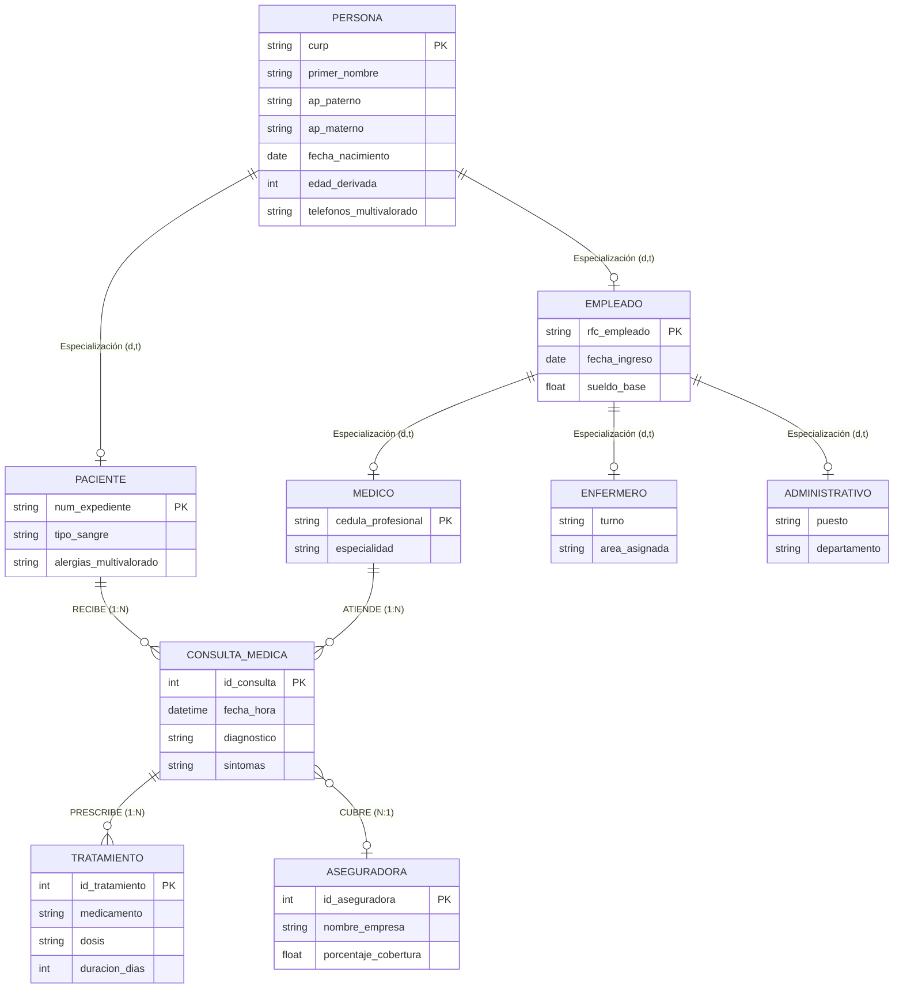

# 📗 Tarea 2.1: Modelado Conceptual E-R y E-R Extendido de un Caso Real

## 👤 Datos de Identificación

* **Estudiante:** Leonardo Martinez Salinas
* **No. de Registro:** I24050412
* **Profesor:** Ruben Miguel Riojas Rodriguez
* **Materia / Unidad:** Fundamentos de Bases de Datos — Unidad 2 (Modelo E-R, E-RE y UML)
* **Fecha:** Noviembre 2026

---

## 📋 Competencia Específica
Conoce y aplica el modelo E-R para el diseño conceptual de bases de datos con el fin de organizar la información y atender necesidades del entorno.

---

## 📌 Desarrollo de los 4 Puntos de la Actividad

### Punto 1: Selecciona un caso de estudio o problemática real del entorno; redacta la descripción contextual y extrae las reglas de negocio.
* **Descripción Contextual:** El Hospital Regional Universitario requería un sistema de información hospitalaria (HIS) para solucionar deficiencias en el seguimiento de expedientes clínicos, duplicidad de datos personales y descontrol en las prescripciones médicas.
* **Reglas de Negocio Institucionales (RN-01 a RN-08):**
  1. **RN-01 (Identificación Global):** Toda persona se identifica de forma unívoca mediante su `CURP` / `id_persona`.
  2. **RN-02 (Jerarquía Excluyente):** Una persona registrada puede ser únicamente `Paciente` o `Empleado` (`Médico`, `Enfermero`, `Administrativo`), siendo roles estrictamente disjuntos y totales `(d, t)`.
  3. **RN-03 (Expediente y Contacto):** De cada `Paciente` es obligatorio registrar su número de expediente clínico único y tipo de sangre. Su edad es derivada (`/edad`) a partir de la fecha de nacimiento y admite múltiples `{telefonos}`.
  4. **RN-04 (Pacientes Internos/Ambulatorios):** Los pacientes se especializan en `Paciente_Interno` (cama, fecha ingreso) y `Paciente_Ambulatorio` `(d, p)`.
  5. **RN-05 (Acreditación Médica):** Del `Médico` es obligatorio registrar su cédula profesional y especialidad.
  6. **RN-06 (Consulta Médica):** Un médico realiza N consultas y un paciente recibe N consultas; cada consulta específica registra fecha, hora, diagnóstico y síntomas.
  7. **RN-07 (Prescripción Terapéutica):** En cada consulta se prescribe 1 o más `Medicamentos` especificando dosis, vía y duración en días.
  8. **RN-08 (Agregación de Cobertura):** La atención médica integral (`Médico` + `Paciente` + `Consulta`) conforma una agregación `[ATENCIÓN_MÉDICA]` que puede contar o no con seguro (`Aseguradora`).

---

### Punto 2: Identifica entidades, atributos (claves, compuestos, derivados, multivalorados) y relaciones con sus cardinalidades y restricciones de participación.

#### Clasificación Rigurosa de Entidades y Atributos:
| Entidad / Clase | Atributo Clave (PK / AK) | Atributos Compuestos y Derivados | Atributos Multivalorados y Simples |
| :--- | :--- | :--- | :--- |
| **Persona (Superclase)** | `curp` [PK] | `nombre` (`primer_nombre`, `ap_paterno`, `ap_materno`), `/edad` [Derivado] | `{telefonos}` {Multivalorado}, `fecha_nacimiento` |
| **Médico (Subclase)** | `cedula_profesional` [PK] | — | `especialidad`, `sueldo_base` |
| **Paciente (Subclase)** | `num_expediente` [PK] | — | `tipo_sangre`, `{alergias}` {Multivalorado} |
| **Paciente_Interno** | `num_expediente` [FK] | — | `num_cama`, `fecha_ingreso`, `piso` |
| **Consulta_Médica** | `id_consulta` [PK] | — | `fecha_hora`, `diagnostico`, `sintomas` |
| **Medicamento** | `id_medicamento` [PK] | — | `nombre_comercial`, `sustancia_activa` |
| **Aseguradora** | `id_aseguradora` [PK] | — | `nombre_empresa`, `porcentaje_cobertura` |

#### Análisis de Relaciones, Cardinalidades y Participación:
* **Realiza (`Médico` : `Consulta_Médica`):** Cardinalidad `1 : N`. Participación Médico (0,N - Parcial), Consulta (1,1 - Total).
* **Recibe (`Paciente` : `Consulta_Médica`):** Cardinalidad `1 : N`. Participación Paciente (0,N - Parcial), Consulta (1,1 - Total).
* **Prescribe (`Atención_Médica` Agregada : `Medicamento`):** Cardinalidad `N : M`.
* **Cubre (`Atención_Médica` Agregada : `Aseguradora`):** Cardinalidad `N : 1`.

---

### Punto 3: Aplica conceptos del modelo E-R extendido (especialización/generalización, jerarquías, agregación).
1. **Jerarquías de Especialización (Superclase/Subclases):** Especialización disjunta y total `(d, t)` de `Persona` en `Médico` y `Paciente`.
2. **Herencia de Atributos:** Las subclases heredan automáticamente todos los atributos de la superclase (`CURP`, `nombre`, `dirección`, `teléfonos`).
3. **Agregación Conceptual:** Encapsulamiento de la relación `ATIENDE` (`Médico` + `Paciente` + `Consulta`) en la entidad agregada `[ATENCIÓN_MÉDICA]` para relacionarse con `Medicamento` y `Aseguradora`.

---

### Punto 4: Diseña el diagrama formal utilizando una herramienta CASE de modelado de software.

#### Diagrama Interactivo E-R Extendido (Mermaid.js):

---

## 📦 Entregables Oficiales

* 📄 **Reporte Técnico en Word/PDF:** `Tarea_2.1.docx` / `Tarea_2.1.pdf`
* 📊 **Diagrama Interactivo:** Código nativo renderizable por GitHub en `Mermaid.js`
* 📹 **Video Explicativo en YouTube:** [Ver Video en YouTube](https://youtu.be/q-M8cpIy658)
