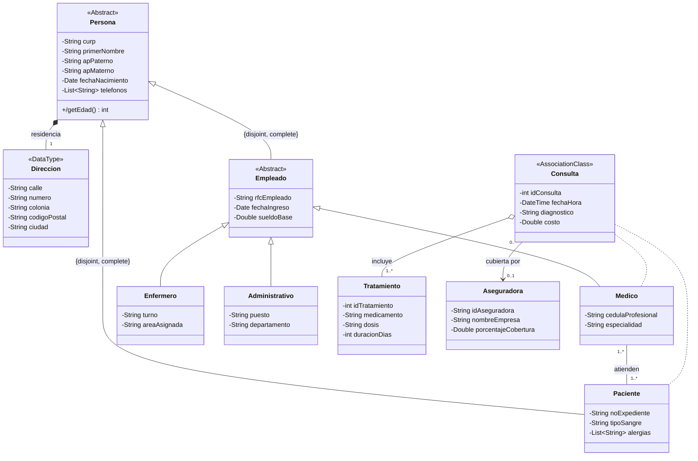

# 📘 Tarea 2.2: Transición de Diagrama E-R a Notación UML

## 👤 Datos de Identificación

* **Estudiante:** Leonardo Martinez Salinas
* **No. de Registro:** I24050412
* **Profesor:** Ruben Miguel Riojas Rodriguez
* **Materia / Unidad:** Fundamentos de Bases de Datos — Unidad 2 (Modelo E-R, E-RE y UML)
* **Fecha:** Noviembre 2026

---

## 📋 Competencia Específica
Conoce y aplica el modelo E-R para el diseño conceptual de bases de datos con el fin de organizar la información y atender necesidades del entorno, realizando la transición hacia diagramas de clases orientados a objetos en notación UML.

---

## 📌 Desarrollo de los 2 Puntos de la Actividad

### Punto 1: Toma el diagrama conceptual E-R de la tarea anterior y conviértelo a diagrama de clases en notación UML.

#### Metodología de Conversión Orientada a Objetos:
1. **Transformación de Entidades en Clases:** Las entidades del modelo E-R se convierten en Clases UML. Las superclases `Persona` y `Empleado` se definen como `<<Abstract>>`.
2. **Propiedades e Identificadores:** Los atributos pasan a propiedades privadas (`-`) especificando su tipo de dato. Las claves primarias utilizan el estereotipo `<<PK>>` o `{id}`.
3. **Atributos Derivados y Compuestos:** El atributo derivado `/edad` utiliza el prefijo `/`. El atributo compuesto `Direccion` se modela mediante relación de **Composición** (`*--`).
4. **Relaciones EER:** Las jerarquías se modelan mediante **Herencia / Generalización** (`<|--`), las consultas con medicamentos como **Agregación** (`o--`), y la relación N:M mediante la **Clase de Asociación `Consulta`**.

#### Diagrama Interactivo de Clases UML (Mermaid.js):

---

### Punto 2: Establece la correspondencia directa entre entidades/clases, atributos/propiedades y relaciones/asociaciones (composición, agregación, herencia).

#### Matriz Comparativa de Correspondencia Directa E-R vs. Notación UML:

| Elemento E-R / EER | Equivalente en Notación UML | Regla de Transformación y Justificación OO |
| :--- | :--- | :--- |
| **Entidad Fuerte / Débil** | Clase UML (Concreta / Abstracta) | Cada entidad se modela como una clase. Superclases como `Persona` y `Empleado` son `<<Abstract>>`. |
| **Atributo Simple** | Propiedad privada (`-`) | Se traduce como atributo de clase privado (`- nombreAtributo: Tipo`). |
| **Atributo Clave (PK)** | Propiedad con `<<PK>>` o `{id}` | Identificador único de la clase. |
| **Atributo Compuesto** | Composición (`*--`) | Se descompone en una clase auxiliar unida por composición fuerte (`Direccion`). |
| **Atributo Derivado** | Propiedad derivada (`/`) o Método | Se denota con `/` (`/edad`) o mediante método (`+getEdad()`). |
| **Atributo Multivalorado** | Colección / Lista | Se modela como lista (`-telefonos: List<String>`). |
| **Jerarquía (EER)** | Herencia / Generalización (`<|--`) | Flecha de generalización triangular hueca dirigida hacia la superclase. |
| **Relación N:M con atributos** | Clase de Asociación (`Association Class`) | La relación `ATIENDE` se convierte en la clase de asociación `Consulta`. |
| **Agregación (EER)** | Agregación (`o--`) | Rombo blanco de agregación indicando pertenencia modular entre `Consulta` y `Tratamiento`. |

---

## 📦 Entregables Oficiales

* 📄 **Documento PDF de la Actividad:** `Tarea_2.2.docx` / `Tarea_2.2.pdf`
* 📊 **Diagrama Interactivo UML:** Código nativo renderizable por GitHub en `Mermaid.js`
* 📹 **Video Explicativo en YouTube:** [Ver Video en YouTube](https://youtu.be/MvEAt6ggGtM)
