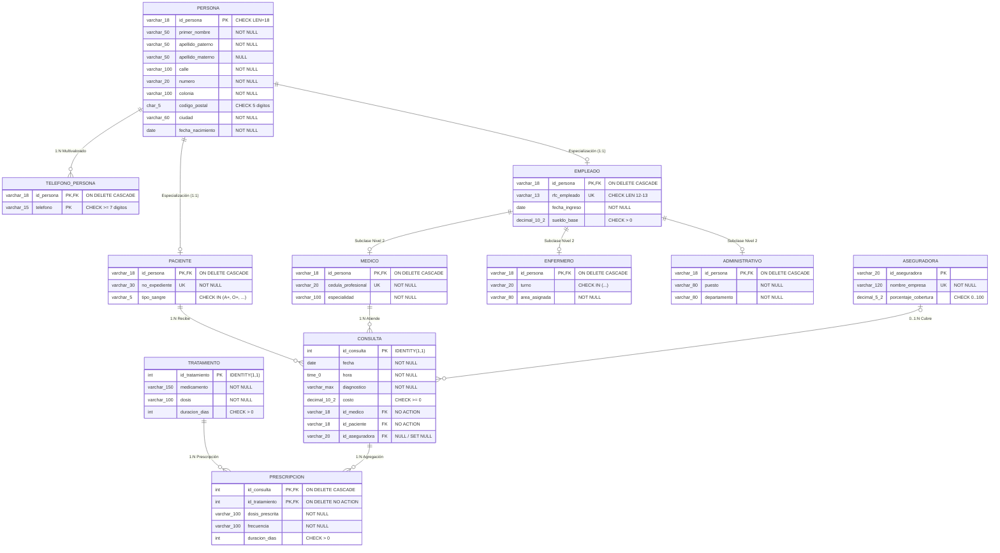

# 📙 Tarea 3.1: Transformación de Modelo E-R a Esquema Relacional y Reglas de Integridad

---

## 👤 Datos de Identificación

- **Nombre:** Leonardo Martinez Salinas
- **Matrícula:** I24050412
- **Maestro:** Ruben Miguel Riojas Rodriguez
- **Asignatura:** Fundamentos de Bases de Datos
- **Institución:** Tecnológico Nacional de México — ITSM Campus Monclova
- **Unidad:** Unidad 3 — Modelo Relacional e Implementación Física DDL

---

## 📝 Descripción

En esta actividad se fundamentan los componentes formales del **Modelo Relacional** y se aplica la transformación metodológica del diagrama conceptual E-R del **Hospital Regional Universitario** hacia un esquema relacional normalizado:
1. **Componentes Formales del Modelo Relacional:** Definición de Dominio ($D$), Atributo ($A$), Relación ($r(R) \subseteq D_1 \times D_2 \times \dots \times D_n$) y Tupla ($t$), junto con su correspondencia en SQL.
2. **Restricciones de Integridad:** Especificación de Integridad de Dominio, Integridad de Entidad (`PRIMARY KEY` / `NOT NULL`) e Integridad Referencial (`FOREIGN KEY` con `CASCADE`, `SET NULL` y `NO ACTION`).
3. **Transformación E-R a Esquema Relacional:** Resolución de atributos compuestos/derivados, atributos multivalorados (`1FN`), jerarquías de especialización multinivel (`PERSONA` $\rightarrow$ `PACIENTE` / `EMPLEADO` $\rightarrow$ `MEDICO` / `ENFERMERO` / `ADMINISTRATIVO`), relación `1:N` opcional (`ASEGURADORA`), agregación (`CONSULTA`) y relación `N:M` (`PRESCRIPCION`) en [`esquema_ddl_hospital.sql`](./esquema_ddl_hospital.sql).

---

## 📊 Visualización de Gráficos

### 1. Diagrama del Esquema Relacional del Hospital Regional Universitario (Mermaid.js)

### 2. Restricciones de Integridad en el Modelo Relacional

| Categoría de Integridad | Definición de la Regla | Mecanismo de Implementación en SQL Server |
| :--- | :--- | :--- |
| **Integridad de Dominio** | Cada atributo debe tomar valores atómicos dentro del dominio permitido. | Tipos de datos (`VARCHAR`, `CHAR`, `DATE`, `DECIMAL`), `NOT NULL` y `CHECK`. |
| **Integridad de Entidad** | Ningún atributo de la clave primaria (`PK`) puede ser `NULL` ni repetirse. | `PRIMARY KEY` simple o compuesta en cada relación. |
| **Integridad Referencial** | Las claves foráneas (`FK`) deben apuntar a una `PK` existente o ser `NULL` si es opcional. | `FOREIGN KEY REFERENCES` con `CASCADE`, `SET NULL` o `NO ACTION`. |

### 3. Mapeo Riguroso del Esquema Relacional

| Tabla Relacional | Atributos / Columnas | Claves (PK / FK / UK) | Transformación Aplicada |
| :--- | :--- | :--- | :--- |
| `PERSONA` | `id_persona`, `primer_nombre`, `apellido_paterno`, `apellido_materno`, `calle`, `numero`, `colonia`, `codigo_postal`, `ciudad`, `fecha_nacimiento` | **PK:** `id_persona` | Superclase raíz con atributos compuestos desglosados (sin `edad` derivada). |
| `TELEFONO_PERSONA` | `id_persona`, `telefono` | **PK/FK:** `(id_persona, telefono)` $\rightarrow$ `PERSONA` (`CASCADE`) | Atributo multivalorado normalizado a 1FN. |
| `PACIENTE` | `id_persona`, `no_expediente`, `tipo_sangre` | **PK/FK:** `id_persona` $\rightarrow$ `PERSONA` (`CASCADE`) \| **UK:** `no_expediente` | Subclase de especialización (Nivel 1). |
| `EMPLEADO` | `id_persona`, `rfc_empleado`, `fecha_ingreso`, `sueldo_base` | **PK/FK:** `id_persona` $\rightarrow$ `PERSONA` (`CASCADE`) \| **UK:** `rfc_empleado` | Subclase de especialización (Nivel 1). |
| `MEDICO` | `id_persona`, `cedula_profesional`, `especialidad` | **PK/FK:** `id_persona` $\rightarrow$ `EMPLEADO` (`CASCADE`) \| **UK:** `cedula_profesional` | Subclase especializada (Nivel 2). |
| `ENFERMERO` | `id_persona`, `turno`, `area_asignada` | **PK/FK:** `id_persona` $\rightarrow$ `EMPLEADO` (`CASCADE`) | Subclase especializada (Nivel 2). |
| `ADMINISTRATIVO` | `id_persona`, `puesto`, `departamento` | **PK/FK:** `id_persona` $\rightarrow$ `EMPLEADO` (`CASCADE`) | Subclase especializada (Nivel 2). |
| `ASEGURADORA` | `id_aseguradora`, `nombre_empresa`, `porcentaje_cobertura` | **PK:** `id_aseguradora` \| **UK:** `nombre_empresa` | Catálogo de cobertura médica. |
| `TRATAMIENTO` | `id_tratamiento`, `medicamento`, `dosis`, `duracion_dias` | **PK:** `id_tratamiento` | Catálogo de tratamientos médicos. |
| `CONSULTA` | `id_consulta`, `fecha`, `hora`, `diagnostico`, `costo`, `id_medico`, `id_paciente`, `id_aseguradora` | **PK:** `id_consulta` \| **FK:** `id_medico`, `id_paciente` (`NO ACTION`), `id_aseguradora` (`SET NULL`) | Entidad agregada de atención médica y relación `1:N` opcional. |
| `PRESCRIPCION` | `id_consulta`, `id_tratamiento`, `dosis_prescrita`, `frecuencia`, `duracion_dias` | **PK/FK:** `(id_consulta, id_tratamiento)` $\rightarrow$ `CONSULTA` (`CASCADE`), `TRATAMIENTO` (`NO ACTION`) | Relación `N:M` con atributos propios. |

---

## 📦 Entregables

- 📄 **Reporte Técnico en PDF:** `Tarea_3.1_Leonardo_Martinez.pdf`
- 💻 **Script SQL DDL:** [`esquema_ddl_hospital.sql`](./esquema_ddl_hospital.sql)
- 🎥 **Video Explicativo en YouTube:** [Ver video en YouTube](https://youtu.be/qlXaavuqU6A)

