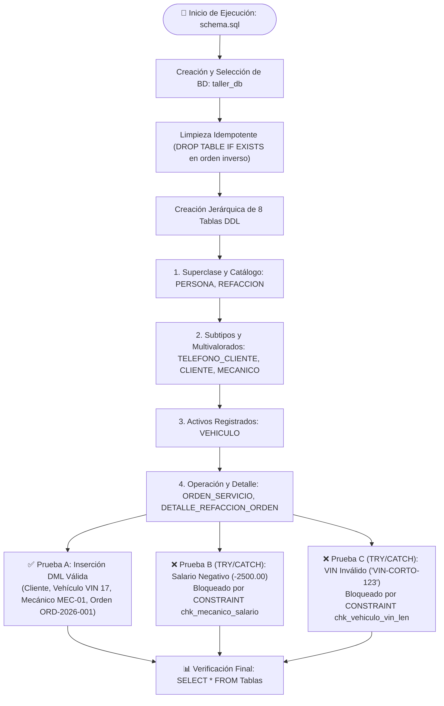

# 🔧 Tarea 3.2: Implementación Física en SGBD y Script DDL (`taller_db`)

## 👤 Datos de Identificación

* **Estudiante:** Leonardo Martinez Salinas

* **No. de Control:** I24050412

* **Semestre / Carrera:** 5° Semestre — Ingeniería en Sistemas Computacionales

* **Asignatura:** Fundamentos de Bases de Datos

* **Catedrático:** Ruben Miguel Riojas Rodriguez

* **Institución:** Tecnológico Nacional de México — ITSM Campus Monclova

## 📝 Descripción

En esta actividad se realiza la implementación física y validación del esquema relacional del **Sistema de Taller Mecánico y Refaccionaria (`taller_db`)** en **Microsoft SQL Server (T-SQL)** mediante el Lenguaje de Definición de Datos (LDD/DDL) y pruebas de integridad con el Lenguaje de Manipulación de Datos (LMD/DML):

1. **Mapeo Físico y Tipos de Datos (T-SQL):** Selección justificada de tipos físicos (`INT IDENTITY(1,1)`, `VARCHAR(18)`, `VARCHAR(17)`, `DECIMAL(10,2)`, `DATE`, `DATETIME2`, `NVARCHAR(MAX)`).

2. **Integridad Referencial y Cascadas:** Configuración de `ON DELETE CASCADE ON UPDATE CASCADE` en tablas dependientes (`TELEFONO_CLIENTE`, `CLIENTE`, `DETALLE_REFACCION_ORDEN`) y `ON DELETE NO ACTION` en entidades con historial operativo (`MECANICO`, `VEHICULO`, `REFACCION`, `ORDEN_SERVICIO`).

3. **Pruebas de Validación (`schema.sql`):** Inserción de datos semilla válidos y bloques controlados `BEGIN TRY ... BEGIN CATCH` para comprobar el bloqueo automático de salarios negativos (`salario_mensual <= 0`) y números de serie vehiculares (`VIN`) con longitud distinta de 17 caracteres.

## 📊 Visualización de Gráficos

### 1. Flujo de Ejecución DDL y Validación de Restricciones en el SGBD (Mermaid.js)

### 2. Estrategia de Tipos de Datos y Mapeo Físico en T-SQL

| Tipo de Dato Lógico | Tipo de Dato Físico (T-SQL) | Justificación Técnica y Dominio | 
| :--- | :--- | :--- | 
| **Claves Primarias Subrogadas** | `INT IDENTITY(1,1)` | Enteros autoincrementables de 4 bytes para llaves artificiales en `PERSONA`, `CLIENTE` y `DETALLE_REFACCION_ORDEN`. | 
| **Identificadores Estándar (`CURP`, `VIN`, `RFC`)** | `VARCHAR(18)` / `VARCHAR(17)` / `VARCHAR(13)` | Cadenas acotadas con verificación estricta de longitud mediante restricciones `CHECK`. | 
| **Nombres, Marcas y Catálogos** | `VARCHAR(40)` a `VARCHAR(100)` | Cadenas de longitud variable optimizadas para almacenamiento sin desperdicio de espacio. | 
| **Fallas y Diagnósticos** | `NVARCHAR(MAX)` | Soporte Unicode extendido para descripciones técnicas detalladas en `ORDEN_SERVICIO`. | 
| **Fechas y Marcas Temporales** | `DATE` / `DATETIME2` | Precisión cronológica para registros de alta y recepción de unidades con `SYSDATETIME()`. | 
| **Importes Monetarios** | `DECIMAL(10,2)` | Precisión decimal exacta para salarios, mano de obra y precios unitarios de refacciones. | 

## 📦 Entregables del Repositorio

* 📄 **Reporte Técnico PDF:** [`Tarea_3.2_Leonardo_Martinez.pdf`](./Tarea_3.2_Leonardo_Martinez.pdf)

* 💻 **Script SQL Formal DDL/DML:** [`schema.sql`](./schema.sql)

* 🎥 **Video Demostrativo en YouTube:** [Ver video en YouTube](https://youtu.be/bm-WJJ45vCk)

