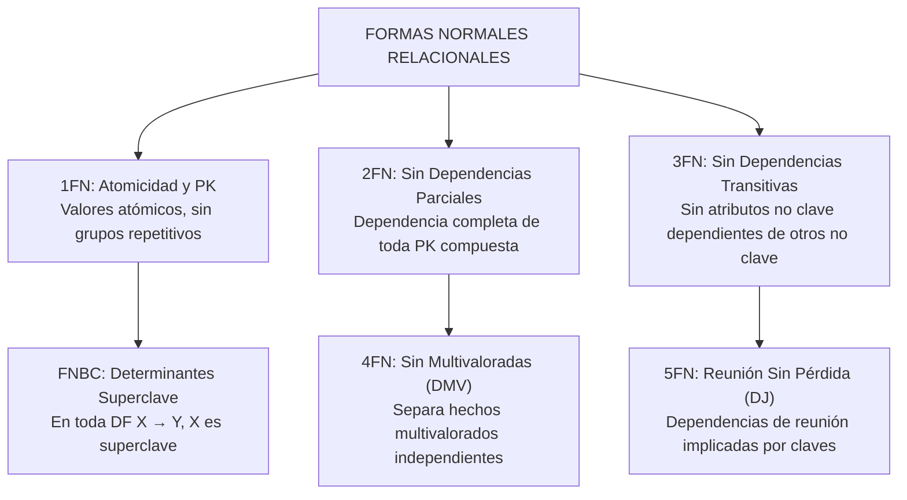

# 📗 Tarea 4.1: Fundamentos de Dependencias y Mapa Conceptual de Formas Normales

---

## 👤 Datos de Identificación

- **Nombre:** Leonardo Martinez Salinas
- **No. de Control:** I24050412
- **Semestre / Carrera:** 5.º Semestre — Ingeniería en Sistemas Computacionales
- **Asignatura:** Fundamentos de Bases de Datos
- **Catedrático:** Ruben Miguel Riojas Rodriguez
- **Institución:** Tecnológico Nacional de México — ITSM Campus Monclova
- **Unidad:** Unidad 4 — Normalización de Bases de Datos Relacionales

---

## 📝 Descripción

En esta actividad se desarrollan los fundamentos teóricos de la normalización relacional, las dependencias funcionales y las formas normales:
1. **Normalización y Dependencias:** Concepto formal de normalización (unión sin pérdida y preservación de dependencias), dependencias funcionales completas, dependencias funcionales parciales y dependencias transitivas.
2. **Anomalías Clásicas:** Análisis de las anomalías de inserción, borrado y modificación en relaciones no normalizadas.
3. **Mapa Conceptual y Formas Normales (1FN a 5FN):** Síntesis visual en Mermaid y desarrollo teórico con ejemplos breves para **1FN**, **2FN**, **3FN**, **FNBC**, **4FN** y **5FN**.

---

## 📊 Visualización de Gráficos

### 1. Mapa Conceptual de Formas Normales (Mermaid.js)

### 2. Resumen de Dependencias y Formas Normales

| Nivel / Concepto | Criterio o Regla Principal | Problema que Resuelve |
| :--- | :--- | :--- |
| **Dependencia Completa** | $X \to Y$ depende de todo $X$ y no de un subconjunto propio. | Define la relación real entre clave compuesta y atributos dependientes. |
| **Dependencia Parcial** | Un atributo no clave depende solo de parte de una `PK` compuesta. | Redundancia de datos repetidos en filas con la misma clave parcial. |
| **Dependencia Transitiva** | $X \to Z$ y $Z \to Y$ sin que $Z$ sea clave candidata. | Repetición de atributos asociados a un determinante no clave. |
| **1FN – 3FN – FNBC** | Atomicidad, eliminación de parciales/transitivos y $X$ superclave en $X \to Y$. | Anomalías de inserción, borrado y modificación en dependencias funcionales. |
| **4FN – 5FN** | Eliminación de DMVs no triviales y dependencias de reunión sin pérdida. | Productos cartesianos redundantes y particiones sin pérdida. |

---

## 📦 Entregables

- 📄 **Reporte Técnico en PDF:** `Tarea_4.1_Leonardo_Martinez.pdf`
- 🎥 **Video Explicativo en YouTube:** [Ver video en YouTube](https://youtu.be/no-XhNZDNkA)
- 🗂️ **Archivos del Documento y Recursos Visuales:** Documentación y mapa conceptual incluidos en este repositorio.

