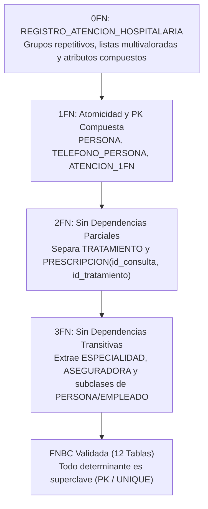

# 📗 Tarea 4.2: Proceso Paso a Paso de Normalización del Proyecto Aplicado

## 👤 Datos de Identificación

* **Nombre:** Leonardo Martinez Salinas
* **No. de Control:** I24050412
* **Semestre / Carrera:** 5.º Semestre — Ingeniería en Sistemas Computacionales
* **Asignatura:** Fundamentos de Bases de Datos
* **Catedrático:** Ruben Miguel Riojas Rodriguez
* **Institución:** Tecnológico Nacional de México — ITSM Campus Monclova
* **Unidad:** Unidad 4 — Normalización de Bases de Datos Relacionales

## 📝 Descripción

En esta actividad se documenta paso a paso la normalización del proyecto **Hospital Regional Universitario (`HospitalRegionalDB`)**, partiendo de una tabla universal desnormalizada (`REGISTRO_ATENCION_HOSPITALARIA`) hasta alcanzar **3FN** y **FNBC**, reflejando la estructura final en [`normalized_schema.sql`](./normalized_schema.sql):

1. **0FN** $\rightarrow$ **1FN (Atomicidad y Eliminación de Grupos Repetitivos):** Descomposición de atributos compuestos (`nombre_completo`, `direccion`), separación de teléfonos multivalorados en `TELEFONO_PERSONA` y aplanamiento de la lista repetitiva de tratamientos.
2. **1FN** $\rightarrow$ **2FN (Eliminación de Dependencias Parciales):** Separación de los datos propios de `CONSULTA` y del catálogo `TRATAMIENTO` respecto a la clave primaria compuesta `(id_consulta, id_tratamiento)` en `PRESCRIPCION`.
3. **2FN** $\rightarrow$ **3FN y Validación FNBC (Eliminación de Dependencias Transitivas):** Extracción de catálogos independientes (`ESPECIALIDAD`, `ASEGURADORA`), consolidación de jerarquías (`PERSONA` $\rightarrow$ `PACIENTE` / `EMPLEADO` $\rightarrow$ `MEDICO`, `ENFERMERO`, `ADMINISTRATIVO`) y verificación de que todo determinante sea superclave.

## 📊 Visualización de Gráficos

### 1. Flujo de Transición de Normalización (0FN a 3FN / FNBC) (Mermaid.js)

### 2. Resumen de Descomposición y Anomalías Corregidas

| Fase | Acción Metodológica | Tablas Resultantes / Actualizadas | Anomalías Eliminadas |
| :--- | :--- | :--- | :--- |
| **0FN** $\rightarrow$ **1FN** | Desglose de atributos compuestos y extracción de grupos repetitivos. | `PERSONA`, `TELEFONO_PERSONA`, `ATENCION_1FN` | Evita celdas multivaloradas y redundancia por listas de teléfonos/medicamentos. |
| **1FN** $\rightarrow$ **2FN** | Eliminación de dependencias parciales sobre `(id_consulta, id_tratamiento)`. | `TRATAMIENTO`, `PRESCRIPCION`, `CONSULTA_2FN` | Permite registrar medicamentos sin necesidad de crear una consulta previa. |
| **2FN** $\rightarrow$ **3FN** | Eliminación de transitividades (`especialidad`, `aseguradora`, roles de persona). | `ESPECIALIDAD`, `ASEGURADORA`, `PACIENTE`, `EMPLEADO`, `MEDICO`, `ENFERMERO`, `ADMINISTRATIVO`, `CONSULTA` | Elimina inconsistencias al actualizar sueldos, especialidades o coberturas. |
| **FNBC** | Verificación de que todo determinante no trivial sea superclave (`PK` / `UNIQUE`). | Esquema final de 12 tablas en `normalized_schema.sql` | Garantiza integridad estructural sin redundancia por claves candidatas. |

## 📦 Entregables

* 📄 **Reporte Técnico en PDF:** `Tarea_4.2_Leonardo_Martinez.pdf`
* 💻 **Script SQL Normalizado:** [`normalized_schema.sql`](./normalized_schema.sql)
* 🎥 **Video Explicativo en YouTube:** [Ver video en YouTube](https://youtu.be/y8nlBKQN5Fs)

