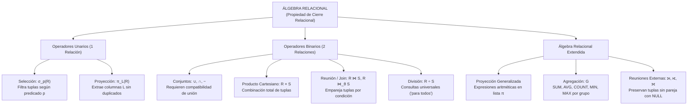

# 📕 Tarea 5.1: Operadores Fundamentales y Extendidos del Álgebra Relacional

---

## 👤 Datos de Identificación

- **Nombre:** Leonardo Martinez Salinas
- **No. de Control:** I24050412
- **Semestre / Carrera:** 5.º Semestre — Ingeniería en Sistemas Computacionales
- **Asignatura:** Fundamentos de Bases de Datos
- **Catedrático:** Ruben Miguel Riojas Rodriguez
- **Institución:** Tecnológico Nacional de México — ITSM Campus Monclova
- **Unidad:** Unidad 5 — Álgebra Relacional y Cálculo Relacional

---

## 📝 Descripción

En esta actividad se desarrollan los fundamentos matemáticos y formales del **Álgebra Relacional** y del **Álgebra Relacional Extendida**:
1. **Operadores Fundamentales Unarios:** Selección ($\sigma_p(R)$), Proyección ($\pi_L(R)$) y Renombramiento ($\rho_S(R)$).
2. **Operadores Fundamentales Binarios:** Unión ($R \cup S$), Intersección ($R \cap S$), Diferencia ($R - S$), Producto Cartesiano ($R \times S$), Reunión / Join ($R \bowtie_\theta S$, $R \bowtie S$) y División ($R \div S$).
3. **Álgebra Relacional Extendida:** Proyección generalizada ($\pi_{F_1, \dots, F_n}(R)$), funciones de agregación y agrupamiento (${}_{G}\mathcal{G}_{F}(R)$) y reuniones externas (`LEFT OUTER JOIN` $\⟕$, `RIGHT OUTER JOIN` $\⟖$ y `FULL OUTER JOIN` $\⟗$).

---

## 📊 Visualización de Gráficos

### 1. Mapa Conceptual de Operadores del Álgebra Relacional (Mermaid.js)

### 2. Resumen de Operadores, Notación y Equivalencia SQL

| Categoría | Operador | Notación Formal | Equivalencia Conceptual en SQL |
| :--- | :--- | :--- | :--- |
| **Unario** | Selección | $\sigma_p(R)$ | `SELECT * FROM R WHERE p` |
| **Unario** | Proyección | $\pi_{A_1, \dots, A_k}(R)$ | `SELECT DISTINCT A1, ..., Ak FROM R` |
| **Binario** | Unión / Intersección / Diferencia | $R \cup S$, $R \cap S$, $R - S$ | `UNION`, `INTERSECT`, `EXCEPT` |
| **Binario** | Producto Cartesiano | $R \times S$ | `SELECT * FROM R CROSS JOIN S` |
| **Binario** | Reunión (Join) | $R \bowtie_\theta S$ / $R \bowtie S$ | `INNER JOIN ... ON θ` / `NATURAL JOIN` |
| **Binario** | División | $R \div S$ | Doble negación con `NOT EXISTS` |
| **Extendida** | Proyección Generalizada | $\pi_{F_1, \dots, F_n}(R)$ | `SELECT expr1 AS alias1 FROM R` |
| **Extendida** | Agregación | ${}_{G}\mathcal{G}_{F(A)}(R)$ | `SELECT G, F(A) FROM R GROUP BY G` |
| **Extendida** | Reuniones Externas | $R \⟕ S$, $R \⟖ S$, $R \⟗ S$ | `LEFT JOIN`, `RIGHT JOIN`, `FULL OUTER JOIN` |

---

## 📦 Entregables

- 📄 **Reporte Técnico en PDF:** `Tarea_5.1_Leonardo_Martinez.pdf`
- 💻 **Archivo Fuente del Informe Técnico:** [`Tarea_5.1_Leonardo_Martinez.html`](./Tarea_5.1_Leonardo_Martinez.html)
- 🎥 **Video Explicativo en YouTube:** [Ver video en YouTube](https://youtu.be/9lf0UsBQwdg)

