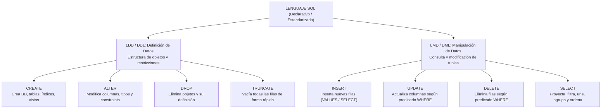

# 📘 Tarea 6.1: Sintaxis y Clasificación de Sentencias SQL (LDD y LMD)

---

## 👤 Datos de Identificación

- **Nombre:** Leonardo Martinez Salinas
- **Matrícula:** I24050412
- **Maestro:** Ruben Miguel Riojas Rodriguez
- **Asignatura:** Fundamentos de Bases de Datos
- **Institución:** Tecnológico Nacional de México — ITSM Campus Monclova
- **Unidad:** Unidad 6 — Lenguaje de Consulta Estructurado (SQL)

---

## 📝 Descripción

En esta actividad se analizan las características generales del lenguaje **SQL** (declaratividad, estandarización ANSI/ISO y distinción entre sublenguajes) y se documenta la taxonomía, sintaxis formal, parámetros, restricciones y opciones avanzadas de las sentencias principales:
1. **Lenguaje de Definición de Datos (LDD / DDL):** `CREATE`, `ALTER`, `DROP` y `TRUNCATE`.
2. **Lenguaje de Manipulación de Datos (LMD / DML):** `INSERT`, `UPDATE`, `DELETE` y `SELECT`.
3. **Referencia Práctica en SQL Server (T-SQL):** Ejemplos estructurados y comprobables sobre el esquema del **Hospital Regional Universitario** (`HospitalRegionalDB`) en [`sentencias_ldd_lmd_6_1.sql`](./sentencias_ldd_lmd_6_1.sql).

---

## 📊 Visualización de Gráficos

### 1. Clasificación Taxonómica de Sentencias SQL (LDD y LMD) (Mermaid.js)

### 2. Tabla Comparativa LDD (DDL) vs. LMD (DML)

| Sentencia | Sublenguaje | Propósito Principal | Cláusulas / Parámetros Clave | Efecto sobre Datos y Esquema |
| :--- | :--- | :--- | :--- | :--- |
| `CREATE` | LDD / DDL | Crear estructuras de base de datos (`DATABASE`, `TABLE`, `INDEX`, `VIEW`). | Columnas, tipos de dato, `PRIMARY KEY`, `FOREIGN KEY`, `UNIQUE`, `CHECK`, `DEFAULT`. | Crea nuevos objetos en el catálogo del sistema. |
| `ALTER` | LDD / DDL | Modificar la estructura de objetos existentes. | `ADD`, `ALTER COLUMN` / `MODIFY`, `DROP COLUMN`, `ADD CONSTRAINT`, `DROP CONSTRAINT`. | Ajusta esquema y reglas; puede requerir validación de datos existentes. |
| `DROP` | LDD / DDL | Eliminar de forma permanente objetos de la base de datos. | `TABLE`, `DATABASE`, `INDEX`, `VIEW`, `CONSTRAINT` (y opciones como `CASCADE` / `NO ACTION` según SGBD). | Borra objeto y definición; respeta restricciones de integridad referencial. |
| `TRUNCATE` | LDD / DDL | Eliminar todas las filas de una tabla conservando su estructura. | `TRUNCATE TABLE <tabla>` (con `RESEED` implícito de identidad en SQL Server). | Libera páginas de datos rápidamente; no admite `WHERE` y exige cuidar `FK`. |
| `INSERT` | LMD / DML | Agregar una o múltiples filas nuevas a una tabla. | `INTO <tabla> (cols) VALUES (...)` o `INSERT INTO ... SELECT ...` y `OUTPUT`. | Agrega tuplas respetando `NOT NULL`, `PK`, `UK`, `FK` y `CHECK`. |
| `UPDATE` | LMD / DML | Modificar valores de columnas en filas existentes. | `SET col = expr`, `FROM ... JOIN ...`, `WHERE <predicado>`, `OUTPUT`. | Actualiza tuplas coincidentes; omitir `WHERE` afecta toda la tabla. |
| `DELETE` | LMD / DML | Eliminar filas específicas de una tabla según condición. | `FROM <tabla>`, `WHERE <predicado>`, `OUTPUT`. | Borra filas una a una y registra en log; respeta reglas `ON DELETE` de `FK`. |
| `SELECT` | LMD / DML | Consultar y proyectar información de una o más tablas. | `SELECT`, `FROM`, `JOIN`, `WHERE`, `GROUP BY`, `HAVING`, `ORDER BY`. | Devuelve un conjunto de resultados sin alterar los datos base. |

---

## 📦 Entregables

- 📄 **Reporte Técnico en PDF:** `Tarea_6.1_Leonardo_Martinez.pdf`
- 💻 **Archivo Fuente del Informe:** [`Tarea_6.1_Leonardo_Martinez.html`](./Tarea_6.1_Leonardo_Martinez.html)
- 🗄️ **Script SQL de Referencia (LDD / LMD):** [`sentencias_ldd_lmd_6_1.sql`](./sentencias_ldd_lmd_6_1.sql)
- 🎥 **Video Explicativo en YouTube:** [Ver video en YouTube](https://youtu.be/PruAbQIWpJ0)
