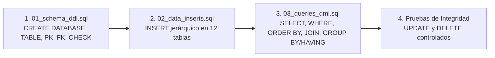

# 📗 Tarea 6.2: Implementación de Script DDL, Carga de Datos y Consultas DML

## 👤 Datos de Identificación

* **Nombre:** Leonardo Martinez Salinas

* **No. de Control:** I24050412

* **Semestre / Carrera:** 5.º Semestre — Ingeniería en Sistemas Computacionales

* **Asignatura:** Fundamentos de Bases de Datos

* **Catedrático:** Ruben Miguel Riojas Rodriguez

* **Institución:** Tecnológico Nacional de México — ITSM Campus Monclova

* **Unidad:** Unidad 6 — Lenguaje de Consulta Estructurado (SQL)

## 📝 Descripción

En esta actividad se implementa de forma modular el ciclo completo de creación, poblado, consulta analítica y mantenimiento transaccional de la base de datos **Hospital Regional Universitario (`HospitalRegionalDB`)** en **Microsoft SQL Server (T-SQL)**:

1. **Definición de Datos (`01_schema_ddl.sql`):** Creación de la base de datos y las 12 tablas normalizadas (3FN / FNBC) con claves primarias, claves foráneas, restricciones `UNIQUE`, `CHECK`, `DEFAULT` y reglas de integridad referencial.
2. **Carga de Datos de Prueba (`02_data_inserts.sql`):** Inserción ordenada de registros representativos en todas las tablas respetando la jerarquía de especialización (`PERSONA` $\rightarrow$ `PACIENTE` / `EMPLEADO` $\rightarrow$ `MEDICO`, `ENFERMERO`, `ADMINISTRATIVO`) y catálogos.
3. **Consultas DML y Pruebas de Integridad (`03_queries_dml.sql`):** Consultas `SELECT` básicas, filtros `WHERE`, ordenamiento `ORDER BY`, agrupaciones `GROUP BY` / `HAVING`, funciones de agregación (`COUNT`, `SUM`, `AVG`, `MAX`, `MIN`), reuniones (`INNER JOIN`, `LEFT JOIN`) y pruebas controladas de `UPDATE` y `DELETE` verificando la integridad referencial.

## 📂 Estructura del Repositorio

```text
├── 01_schema_ddl.sql                 # Fase 1 (LDD): Creación de BD, tablas y restricciones
├── 02_data_inserts.sql               # Fase 2 (LMD): Poblado inicial de datos de prueba
├── 03_queries_dml.sql                # Fase 3 (LMD): Consultas SELECT, JOIN, agregaciones y UPDATE/DELETE
├── Tarea_6.2_Leonardo_Martinez.html  # Archivo fuente del reporte técnico
├── Tarea_6.2_Leonardo_Martinez.pdf   # Reporte técnico con evidencias de ejecución
└── README.md                         # Guía de clonación y ejecución en el SGBD
```

## 🚀 Instrucciones para Clonar y Ejecutar en el SGBD

### 1. Clonar el repositorio

```bash
git clone <URL_DE_TU_REPOSITORIO_GITHUB>
cd <NOMBRE_DEL_REPOSITORIO>
```

### 2. Ejecutar los scripts en orden en SQL Server Management Studio (SSMS) o `sqlcmd`

> **Importante:** Ejecuta los archivos estrictamente en orden numérico (`01` $\rightarrow$ `02` $\rightarrow$ `03`) para respetar las dependencias de esquema e integridad referencial.

* **Opción A — Desde SQL Server Management Studio (SSMS):**
  1. Conéctate a tu instancia local de SQL Server (por ejemplo, `localhost\SQLEXPRESS`).
  2. Abre y ejecuta `01_schema_ddl.sql` (`F5`) para crear `HospitalRegionalDB` y sus 12 tablas.
  3. Abre y ejecuta `02_data_inserts.sql` (`F5`) para cargar los datos de prueba.
  4. Abre y ejecuta `03_queries_dml.sql` (`F5`) para obtener los conjuntos de resultados y validar las pruebas de `UPDATE` y `DELETE`.

* **Opción B — Desde terminal con `sqlcmd`:**

```bash
sqlcmd -S localhost\SQLEXPRESS -E -i 01_schema_ddl.sql
sqlcmd -S localhost\SQLEXPRESS -E -i 02_data_inserts.sql
sqlcmd -S localhost\SQLEXPRESS -E -i 03_queries_dml.sql
```

## 📊 Visualización del Flujo de Ejecución (Mermaid.js)



## 📦 Entregables

* 📄 **Reporte Técnico en PDF:** `Tarea_6.2_Leonardo_Martinez.pdf`
* 🗄️ **Script LDD:** [`01_schema_ddl.sql`](./01_schema_ddl.sql)
* 🗄️ **Script de Carga LMD:** [`02_data_inserts.sql`](./02_data_inserts.sql)
* 🗄️ **Script de Consultas y Mantenimiento LMD:** [`03_queries_dml.sql`](./03_queries_dml.sql)
* 🎥 **Video Explicativo en YouTube:** [Ver video en YouTube](https://youtu.be/AQoLJmofaAo)